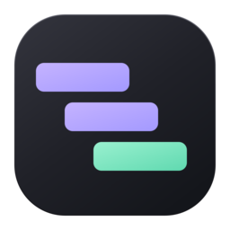

<p align="center">
  
</p>

# HAR Viewer

A native HTTP archive inspector built with **Rust, GPUI and
[GPUI Component](https://gpui-kit.com)**, with a Gruvbox Dark theme, faceted
filters and a request inspector. This is a native application, not a browser wrapper.

## Run with Nix

Enable Nix flakes, then run from a **macOS desktop** or a **Linux X11/Wayland desktop**:

```sh
nix run github:thekorn/har-viewer -- --input /path/to/capture.har
# From this checkout, explore the fictional fixture:
nix run . -- --input fixtures/sample.har
```

`--input <har file>` is required and loads one capture at launch. Quote paths containing
spaces. Positional paths and `--sample` are not accepted. The window shows only a
loading screen while the capture is read and parsed. To inspect another file, quit
and relaunch with a different `--input`; there is no file picker, path field or file
drop support. A failed load shows an error with relaunch instructions.

Packages and development shells are provided for Linux (x86_64 and aarch64) and
Apple Silicon macOS (aarch64). macOS uses native Cocoa windows and Metal; it does
not need XQuartz, Vulkan, or a Linux VM. The pinned Nixpkgs has dropped Intel Mac
support; Intel macOS and Windows are not supported by this flake.

On Linux, GPUI needs Vulkan. On NixOS, enable `hardware.graphics.enable`. On other Linux
distributions, or machines without a usable Vulkan GPU, use the bundled software
renderer (slower, but does not require a host GPU driver):

```sh
HAR_VIEWER_SOFTWARE=1 nix run github:thekorn/har-viewer -- --input /path/to/capture.har
```

### Desktop installation and icon

The Nix package includes the Waterfall app icon. On Linux it installs a
`dev.thekorn.har-viewer.desktop` launcher and hicolor PNG/SVG icons. Install the
package through your NixOS/Home Manager configuration or `nix profile install .`
from this checkout, with the profile's `share` directory in the desktop session's
`XDG_DATA_DIRS`. A one-off `nix run` does not register a desktop launcher. GPUI
supplies the matching X11 window class / Wayland app ID; desktop shells use it to
find the icon. X11 window managers that require `_NET_WM_ICON` may still show a
generic window icon because GPUI 0.2.2 does not set that property.

On macOS, `nix develop --impure -c har-package` produces
`result/Applications/HAR Viewer.app`, including its Finder/Dock icon. Launch with
`open -n "result/Applications/HAR Viewer.app" --args --input /path/to/capture.har`.
The packaged CLI also executes the binary inside the bundle. Launching from Finder
or a desktop menu without arguments cannot open a capture; use the CLI with `--input`.
Plain `cargo run` is unbundled and does not provide the macOS app icon.

## First iteration

- Load via `--input` at startup; a fictional shopping capture lives in
  `fixtures/sample.har` for exploration. Parsing runs in the background.
- Virtualized component table; sort by method, URL, status, type, size or duration
  using each column's sort icon (descending, ascending, then capture-time order).
  All columns remain available with horizontal scrolling; close the inspector for
  more table space.
- Case-insensitive URL/method/status and fulltext request/response search; status,
  method, resource type and domain filters; slow-request preset. Choices within a
  facet are OR, facets AND.
  Sidebar counts describe the whole capture; table and overview reflect filters.
- Headers, request payload, JSON/text response, cookies, additive timing phases and
  original entry JSON. Base64 text is decoded; binary content is identified.
- Waterfall and request histogram, overview totals and per-domain distribution,
  local issue checks for errors, latency, large responses and uncached assets.
  Click a histogram bar in Requests or Waterfall to select and reveal the first
  matching row in the current filtered/sorted table; empty windows do nothing.
  Double-click a Waterfall row to open the same request in Requests and its inspector,
  keeping the current filters, sort order and inspector tab.
- Copy URL, shell-quoted cURL or inspector content. No HAR export or HAR clipboard copy.
- Native Unicode input, clipboard and keyboard navigation.

No telemetry, uploads, replay or remote requests. HAR files often contain passwords,
cookies and tokens: **clipboard copies are NOT sanitized**. Review them
before sharing. Resource sizes are decoded HAR content sizes, not wire transfer sizes;
unknown sizes contribute zero to totals. Unknown timestamps do not extend capture time.

### Search syntax

Use the same search bar for quick filters and fulltext search. Hover **?** beside
it for examples. Searches are case-insensitive literal substrings, not regex.

| Query | Matches |
| --- | --- |
| `checkout` or `503` | URL, method or status, as before |
| `text:coupon` | Any captured request or response field, including text bodies |
| `request:SPRING-DEMO` | Request fields only, including payload |
| `response:"Amber reading lamp"` | An exact phrase in response fields or body |
| `POST text:coupon -response:expired` | All three conditions: POST metadata, coupon anywhere, no expired in the response |

Whitespace separates terms joined with **AND**; each term may match a different
field of the same entry. Quote text containing spaces to search it as one phrase.
Prefix any term with `-` to exclude it. Sidebar facets still combine with the query
using AND. Prefixes are case-insensitive; only `text:`, `request:` and `response:`
are special, so URLs with colons work without quoting. Quote an entire token to
search a literal prefix or leading minus: `"text:example"` or `"-draft"`.
Inside quotes, `\"` and `\\` represent a literal quote and backslash; other
backslashes stay literal. While typing, empty terms are ignored and an unclosed
quote extends to the end of the query.

Fulltext covers field names and values under each entry's `request` and `response`:
URLs, headers, cookies, query/form parameters, status text, MIME types, extension
fields and complete textual bodies, including base64-decoded UTF-8. It searches
the captured body text without JSON reformatting or preview truncation. Binary,
invalid-base64 and unsupported-encoding bodies are skipped, but their other fields
remain searchable. Entry-level timings/comments and capture metadata are outside
these scopes. Searches run locally and never fetch missing bodies or captured URLs.

### Shortcuts

Use **Command (⌘)** instead of **Ctrl** on macOS. In-app hints follow the platform.

| Shortcut | Action |
| --- | --- |
| Ctrl F | Focus request search |
| ↑ / ↓ | Previous / next visible request (outside text fields) |
| Enter | Return focus from search to the request list |
| Escape | Return focus to the request list; dismiss inspection errors, not startup errors |
| Ctrl Shift C | Copy selected URL |
| Ctrl Q | Quit |

### Deliberate limits

HAR-Files are limited to 1 GiB (1,073,741,824 bytes). Body previews show at most 5,000
lines, 2,000 characters per line; **Copy content** retains the full value.
Inspector source scrolls horizontally.
Unpaired UTF-16 surrogate escapes in JSON string values are loaded as `�`, with a
validation warning in Issues. Clipboard copies contain these replacements, not
the original code units; the source file is never modified. Unpaired surrogates
in object keys are rejected to avoid merging distinct fields. Valid surrogate
pairs and literal backslash-u text are preserved; other malformed JSON is rejected.
Minimum window size is 1100 × 650. Captures are in memory only; nothing restores on restart.
This is not feature parity with the reference: comparison, replay,
image previews, JSON trees, regex search, saved views, notes/pins, resizing panels,
light theme, websocket tooling and initiator trees remain future work.

## Development: everything in devenv

Only Nix is needed on the host. `flake.lock` pins nixpkgs and devenv; `Cargo.lock`
pins Rust dependencies. The flake's development shell **is** a `devenv.lib.mkShell`
using `devenv.nix`; there is no parallel ad-hoc toolchain or system package setup.
Use `nix develop --impure` on both platforms for the pinned CI toolchain.
The standalone `devenv shell` command also reads this module, but resolves its own
inputs in `devenv.lock`, independently of `flake.lock`.

```sh
nix develop --impure
har-dev --input fixtures/sample.har
har-check       # rustfmt, Clippy -D warnings, Rust tests, nixfmt, statix, deadnix
har-coverage    # domain + session coverage, minimum 90% lines (not a UI coverage claim)
har-build      # release Cargo build
har-package    # Nix distribution build, including Rust tests
har-smoke      # Linux: isolated Xvfb + software Vulkan; build debug first
# macOS: har-smoke --use-desktop (see permissions below)
```

For automation use `nix develop --impure -c har-check`, etc. `--impure` lets devenv
locate the checkout; the distribution package itself builds in pure Nix evaluation.
Build sandboxing is separate: it follows the Nix daemon's `sandbox` setting.
In particular, do not treat a successful macOS package build as sandbox validation
when sandboxing is disabled or the daemon rejects an untrusted override.
Direnv users can run `direnv allow`. For software rendering during development:
`har-software har-dev --input fixtures/sample.har` on Linux. On macOS, `har-software` simply runs its
command with the native Metal renderer.

```sh
nix develop --impure -c cargo build --locked
nix develop --impure -c har-smoke --artifacts .amp/in/artifacts
nix develop --impure -c har-smoke --binary ./result/bin/har-viewer
```

On macOS, the same smoke assertions run against the real desktop, not Xvfb:

```sh
nix develop --impure -c cargo build --locked
nix develop --impure -c har-smoke --use-desktop --artifacts .amp/in/artifacts
nix develop --impure -c har-smoke --use-desktop --binary ./result/bin/har-viewer
```

Unlock the screen and leave the desktop idle during this test. It focuses only
the app it starts, requires room for a 1440 × 900 content area, and preserves the
clipboard in memory (restoring it unless it changed outside the test). Grant the
launching terminal/Python **Accessibility** and **Automation → System Events**
permissions in System Settings. **Screen Recording** is needed only with
`--artifacts`; captures contain only the owned app window and fictional fixture.
The script never changes privacy permissions. Video recording (`--record`) is
Linux-only. None of these automation permissions are needed for normal app use.

Tests cover malformed/partial HAR, timezone offsets, timing arithmetic, unknown
sizes, stable sorting, combined filters, Unicode search, base64 errors, metadata
round trips, real shell argument quoting, and navigation after filtering. The
desktop smoke test asserts request selection and clipboard data through real keyboard
and pointer input, including sorting, facets, response inspection, the loading
transition and the removed open/export shortcuts. With `--artifacts`, it also captures
startup errors for visual review.

CI builds and checks only Ubuntu 24.04 on x86_64, including Nix packages, the
headless CLI contract, and debug and packaged desktop smoke tests. The matrix
contains one runner; aarch64 packages remain available but are not built in CI.
macOS validation is manual for now; native rendering/interaction must be checked
on an unlocked Mac with Metal and the permissions above.

CI caches the Nix store and Cargo dependencies (including coverage build artifacts)
separately. Keys track the pinned toolchain and dependency/build configuration,
not each source commit. Pull requests restore caches; only successful pushes to
`main` save them. Nix garbage collection targets a 6 GiB store before saving,
but rooted build and shell closures can exceed that target. Cache hits never skip
checks or tests, and no additional cache service credentials are required.

`libc` is locked to 0.2.186 because GPUI 0.2.2's transitive `xattr` 0.2.3 uses
`ENOATTR`, removed in libc 0.2.190. Do not blindly update that lock entry without
fixing/upgrading the upstream chain. The build currently also reports an upstream
future-compatibility warning in `proc-macro-error2`, and in `block` on macOS.

Known dependency advisory: GPUI 0.2.2 pins Taffy 0.9.0, which pulls in Grid 0.18.0
affected by [GHSA-38c5-483c-4qqp](https://github.com/advisories/GHSA-38c5-483c-4qqp)
(moderate, integer overflow in `expand_rows`). Taffy 0.9.2 permits the fixed Grid
1.0.1, but GPUI's exact pin prevents a lockfile-only upgrade. This app uses flex
and absolute layout, and Taffy's inspected grid occupancy code does not call
`expand_rows`; that is not a guarantee of safety. The dependency alert remains
open pending an upstream-compatible fix. Static-analysis success does not mean
the dependency graph is free of known advisories.

## Structure

`src/har.rs` is the pure parsing/analysis/export layer (the library export API remains
available, but is not exposed in the app); `src/search.rs` parses and matches search
terms without UI dependencies; `src/session.rs` owns visible
selection and navigation. `src/app.rs` composes library components and coordinates
native I/O; `src/request_table.rs` adapts the session to the library's virtualized
table. Buttons, inputs (including the read-only inspector editor), tabs, sidebar,
alerts, histogram, progress bars and scrollbars come from GPUI Component. Only the
HAR-specific stacked waterfall rendering remains application-owned. No network or
filesystem operations live in the HAR model. Nix runtime libraries are shared
between the devenv shell and distribution package.

GPUI Component and its embedded icon assets are pinned to **0.5.1**, the last stable
release compatible with GPUI **0.2.2**. Current GPUI Kit releases require a different
GPUI engine; upgrading them is not a drop-in dependency update. No webview or
remote assets are used. `assets/gruvbox-dark.json` defines the Gruvbox Dark component
and editor colors; waterfall phases use the same palette. Table headers and alerts
use normal foreground text for readability; fonts use the platform defaults already
packaged by this project.

`assets/icon.svg` is the editable Waterfall artwork. The checked-in PNG sizes and
macOS ICNS are generated from it, with transparent margins. Regenerate on Linux
using `nix develop --impure -c python assets/generate.py`; no extra tools are needed.
After `har-package`, run `nix develop --impure -c python tests/package.py` to check
the packaged launcher/bundle, icon resources and headless CLI on either platform.

## License and credits

MIT for this application. GPUI and GPUI Component are Apache-2.0; the bundled Lucide
icons are ISC/MIT. See [THIRD_PARTY_NOTICES.md](THIRD_PARTY_NOTICES.md).
